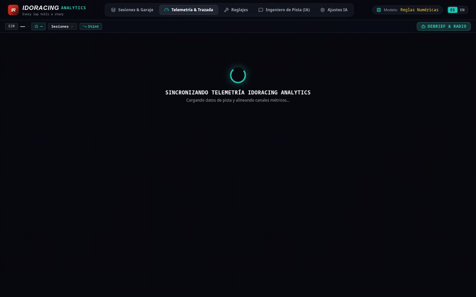
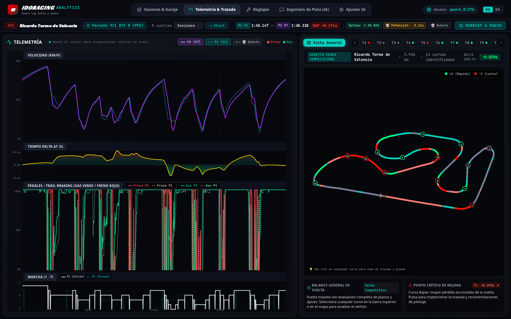
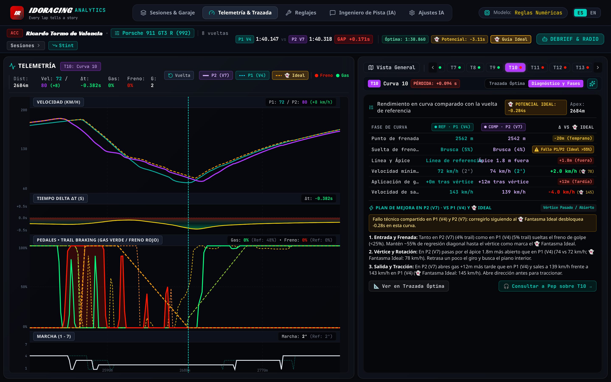
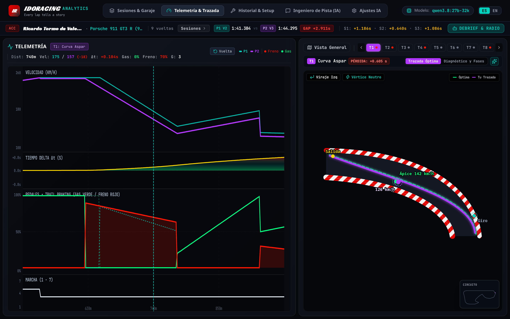

# IdoRacing Analytics 🏎️

> ### **Every lap tells a story.**
> **Multi-sim telemetry analysis. Built for faster laps.**

[](https://github.com/miquelbar/idoracing/actions/workflows/ci.yml)
[](LICENSE)
[](https://www.python.org/)
[](https://react.dev/)
[](https://www.typescriptlang.org/)
[](https://ollama.ai/)
**IdoRacing Analytics** is a modern, high-performance, open-source motorsport telemetry suite and AI race engineer. Designed specifically for **amateur simracers** who want to understand where they are losing time, master trail braking, optimize racing lines, and find real lap time improvements—**without paying costly monthly subscriptions** (like Coach Dave Delta, VRS, or MoTeC i2 Pro complexity).



Supports:
- **Assetto Corsa Competizione (ACC)**
- **Le Mans Ultimate (LMU)**
- **iRacing** (MoTeC & CSV exports)
- **Universal CSV Logs**

---

## 💡 The Philosophy

Most telemetry software falls into two extremes:
1. **Enterprise engineering tools (MoTeC i2 Pro, Bosch Motorsport)**: Incredibly powerful, but steep learning curve, requires hours of manual workspace configuration, and shows raw mathematical channels without context.
2. **Paid SaaS platforms ($10–$25/month)**: Monthly subscription fees, proprietary file formats, and data sent to third-party cloud servers.

**IdoRacing Analytics bridges the gap:**
- **100% Free & Open Source**: Run it locally on your PC or home network.
- **Privacy-First**: Your driving telemetry and setups never leave your machine.
- **Pro-Grade Visuals**: 2D track heatmaps, corner-by-corner racing line SVG comparisons, synchronized 50Hz traces, and live delta-T graphs.
- **Integrated AI Race Engineer**: Explains *why* you are losing time and *what* technique to apply (using local Ollama with `qwen3.8:27b-32k` or cloud LLMs like OpenAI/OpenRouter).

---

## 🌟 Key Features

### 1. 🗺️ 2D Track Map & Speed Heatmap
- Closed-loop circuit rendering computed from velocity, yaw rate, and lateral acceleration.
- Visual speed delta ($\Delta V$) heatmap across the entire lap.
- Interactive corner segmentation—click any corner on the map to jump directly into its analysis.
- Multi-track support with pre-calibrated layouts (Circuit Ricardo Tormo Valencia, Sebring International Raceway, and universal coordinates).


*Unified 100vh multi-channel telemetry workspace: Speed, Delta-T, Pedals with Trail Braking overlap, Gear, and interactive Circuit Map.*

### 2. 🔍 Corner-by-Corner Racing Line & Technique Inspector
- **Corner Phase Breakdown Table**: Structured 4-column phase performance analysis comparing your corner entry, apex, and exit against the reference lap:
  - `FASE DE CURVA` | `REFERENCIA` | `TU VUELTA` | `DIFERENCIA`
  - **Braking Point Delta**: Pinpoints whether you braked too early or arrived overloaded into the corner entry.
  - **Trail Braking Modulation**: Evaluates progressive pedal bleed-off vs. abrupt release to maintain front tire grip.
  - **Track Position & Line**: Identifies entry tightening, understeer offsets (+1.8m wide off apex), or early apex pinching.
  - **Minimum Speed ($V_{min}$) & Apex Gear**: Detects overslowing and incorrect downshifts upsetting chassis balance.
  - **Throttle Onset Distance & Exit Speed**: Measures post-apex throttle commitment and corner exit momentum.
  - **Direct Radio Feedback Loop**: One-click jump to chat with Pep about the specific corner (`[ 🎧 Consultar a Pep sobre T1 → ]`).


*Corner Phase Breakdown Table: braking point delta, trail braking modulation score, minimum apex speed, and Pep's engineering debrief.*

- **High-Resolution 2D Trajectory Inspector**: Compare your driven line vs. optimal line, with marked Entry, Apex, and Exit points, curb boundaries, and speed delta shading.
- **Segmented Mode Toggle**: Instant switching between **Trazada Óptima** (2D Trajectory) and **Diagnóstico y Fases** (Corner Phase Table) without vertical scrolling.


*High-resolution 2D Corner Trajectory analysis with curbs, speed delta ribbon, and apex alignment.*

### 3. 📈 50Hz Synchronized Telemetry Traces
- **Speed**: Reference vs. comparison lap with apex minimum speed markers.
- **Cumulative Time Delta ($\Delta t$)**: Color-coded area chart showing continuous time gains (green) and losses (red).
- **Pedals (Throttle & Brake)**: 0–100% synchronized inputs with trail braking overlap indicator.
- **Steering Angle**: Degrees of steering wheel rotation to spot mid-corner corrections and scrubbing.
- **Gear & Engine**: Gear selection over lap distance.
- **Synchronized Hover Scrubbing**: Move your mouse across any channel to see synchronized distance, speed, and delta values across all plots simultaneously.

### 4. 🤖 Meet "Pep" — Your AI Race Engineer & Radio Partner (PEP · Performance Engineering Partner)
- **Identity & Persona**: Pep is your dedicated pit-wall Performance Engineering Partner (a nod to IdoRacing's origins in Mallorca). Pep communicates like a real race engineer: direct, technical, 100% grounded in telemetry data, with zero generic fluff.
- **Mathematical Rigor & Zero False Praise**: Strictly derives feedback from real telemetry deltas ($\Delta V$, $\Delta t$, braking points). Pep never offers unwarranted congratulations if time is lost or apex speed drops.
- **Interactive Team Radio & Contextual Queries**: Chat directly with Pep over team radio (`[ 🎧 Consultar a Pep sobre T1 → ]`) to diagnose trail braking modulation, entry understeer, chassis balance, and car setup adjustments.
- **Local & Private (Ollama)**: Default configuration runs locally with `qwen3.8:27b-32k` (or `qwen3:14b`/`qwen3:8b`) with CUDA acceleration.
- **Cloud-Compatible (OpenAI / OpenRouter)**: Easily plug in GPT-4o, Claude 3.5, or DeepSeek via standard OpenAI-compatible API keys.
- **Deterministic Engineering Engine**: If Ollama or cloud APIs are unavailable, a deterministic rule-based telemetry engine generates instant structured debriefs and authentic pit-wall responses.

### 5. 🗄️ Unified Session Hub & Car Setup History
- Switch tracks, cars, and sessions seamlessly from a single hub.
- Compare your current session against historical Personal Bests (PB).
- Inspect car setup parameters (tire pressures, brake bias, aero balance, suspension settings).
- One-click synthetic demo generator for instant exploration without importing files first.

### 6. 📂 Simulator Auto-Discovery & File Ingestion
- **Automatic Steam Detection**: Automatically scans default Proton / Steam paths for telemetry files on Linux and Windows.
- **Drag-and-Drop Ingestion**: Upload `.ld` MoTeC binary files, `.ldx` lap markers, `.xml` session results, or `.csv` logs directly from the web interface.

---

## 🎮 How to Record Telemetry in Your Sim

### 🏎️ Assetto Corsa Competizione (ACC)
1. Load into the track and enter the **Car Setup** menu.
2. Go to the **Electronics** or **Fuel & Strategy** tab.
3. Look for the **Telemetry Laps** setting and increase it to **10–20 laps** (default is `0` = disabled).
4. Complete your laps and return to the pit box. ACC will save `.ld` and `.ldx` files to:
   - **Windows**: `Documents\Assetto Corsa Competizione\MoTeC\`
   - **Linux (Proton)**: `~/.local/share/Steam/steamapps/compatdata/805550/pfx/drive_c/users/steamuser/Documents/Assetto Corsa Competizione/MoTeC/`

### 🏁 Le Mans Ultimate (LMU)
1. LMU logs race and practice session data automatically in XML format upon exiting the session.
2. Files are located in:
   - **Windows**: `<SteamLibrary>\steamapps\common\Le Mans Ultimate\UserData\Log\Results\`
   - **Linux (Steam)**: `~/.local/share/Steam/steamapps/common/Le Mans Ultimate/UserData/Log/Results/`
3. IdoRacing Analytics auto-detects these XML session files and imports your lap times and sector deltas instantly.

### 🏁 iRacing
1. While in the car, press **`Alt + L`** to start/stop telemetry recording (or set automatic logging in iRacing Options).
2. Telemetry `.ibt` files are written to `Documents\iRacing\telemetry\`.
3. Export to `.ld` (using the free MoTeC iRacing plugin) or export as CSV via Mu / Atlas.
4. Drag and drop the resulting `.ld` or `.csv` file into IdoRacing Analytics.

---

## 🏗️ Architecture

```
idoracing-analytics/
├── api/                # FastAPI backend serving REST endpoints & static assets
│   └── server.py       # API routes, CORS, session uploads, LLM proxy
├── frontend/           # High-performance React 19 + TypeScript + Vite + Tailwind CSS
│   ├── src/components/ # TrackMap2D, TelemetryCharts, CornerInspector, TimingTower
│   ├── src/views/      # SessionsView, TelemetryView, SetupHistoryView, EngineerView, SettingsView
│   ├── src/services/   # Typed API client
│   └── src/types/      # Telemetry DTOs and type definitions
├── domain/             # Pydantic v2 core models (Session, Lap, LapComparison, CoachReport)
├── importers/          # Multi-sim ingestion engine:
│   ├── moteclib/       # Fast binary decoding for MoTeC .ld & XML .ldx
│   ├── lmu_importer.py # Le Mans Ultimate session XML results parser
│   ├── csv_importer.py # Universal CSV importer
│   └── synthetic.py    # Deterministic telemetry generator for testing & demo
├── analysis/           # Physics & telemetry analysis pipeline:
│   ├── alignment.py    # Distance-based interpolation & resample (50Hz)
│   ├── corners.py      # Corner segmentation, apex detection, trail braking score
│   ├── lap_comparison.py# Delta-T calculation, micro-sectors, speed deltas
│   └── tracks.py       # 2D track geometries & closed-loop circuit coordinates
├── storage/            # SQLite storage with indexing for sessions, setups, and debriefs
├── coach/              # AI Race Engineer module:
│   ├── advisor.py      # Telemetry prompt formatting & debrief synthesis
│   ├── llm_client.py   # Dual client for Ollama & OpenAI/OpenRouter
│   └── prompt.py       # Grounded system prompts and motorsport heuristics
└── tests/              # 28 automated pytest unit & integration tests
```

---

## 🚀 Quickstart

### Option A: Local Python & Node (Recommended)

#### 1. Prerequisites
- Python 3.11+
- Node.js 20+ and npm

#### 2. Clone & Setup Backend
```bash
git clone https://github.com/miquelbar/idoracing.git
cd idoracing

# Create and activate Python virtual environment
python3 -m venv .venv
source .venv/bin/activate

# Install Python dependencies
pip install -r requirements.txt
```

#### 3. Build Frontend
```bash
cd frontend
npm install
npm run build
cd ..
```

#### 4. (Optional) Setup Local AI with Ollama
If you want free, 100% private AI race coaching:
```bash
# Install Ollama (https://ollama.ai)
curl -fsSL https://ollama.ai/install.sh | sh

# Pull the recommended model (Qwen 2.5/3 27B)
ollama pull qwen3.8:27b-32k
```
*(Alternatively, you can configure an OpenAI or OpenRouter API key in the web app under **Ajustes IA** or in `.env`)*.

#### 5. Launch IdoRacing Analytics
```bash
source .venv/bin/activate
uvicorn api.server:app --host 0.0.0.0 --port 8501
```

Open your browser at:
- **Local**: `http://localhost:8501`
- **Home Network (LAN)**: `http://<your-ip>:8501`

---

### Option B: Docker Compose

1. **Configure environment:**
   ```bash
   cp .env.example .env
   ```

2. **Launch with Docker Compose:**
   ```bash
   docker compose up --build
   ```

3. Access the web app at `http://localhost:8501`.

---

## 🧪 Testing & Code Quality

IdoRacing Analytics is built with rigorous quality standards and includes 28 automated tests covering binary parsing, distance alignment, corner detection, SQLite storage, and API contracts.

Run the test suite:
```bash
source .venv/bin/activate
pytest -v
```

All 28 tests pass:
```
tests/test_analysis.py ................. PASSED
tests/test_api.py ...................... PASSED
tests/test_coach.py .................... PASSED
tests/test_csv_importer.py ............. PASSED
tests/test_domain.py ................... PASSED
tests/test_lmu_importer.py ............. PASSED
tests/test_motec_binary.py ............. PASSED
tests/test_storage.py .................. PASSED
test_importers/test_moteclib_importer.py PASSED
======================= 28 passed in 1.77s =======================
```

---

## 🛠️ Configuration (.env)

| Variable | Default | Description |
|---|---|---|
| `LLM_PROVIDER` | `ollama` | AI Provider: `ollama` or `openai` |
| `OLLAMA_BASE_URL` | `http://localhost:11434` | Ollama API endpoint |
| `OLLAMA_MODEL` | `qwen3.8:27b-32k` | Local model name (e.g., `qwen3.8:27b-32k`, `qwen3:14b`) |
| `OLLAMA_TIMEOUT` | `90.0` | Timeout in seconds for AI response generation |
| `OPENAI_API_KEY` | *(empty)* | Optional API key for OpenAI / OpenRouter / DeepSeek |
| `OPENAI_BASE_URL` | `https://api.openai.com/v1` | Optional endpoint (use `https://openrouter.ai/api/v1` for OpenRouter) |
| `OPENAI_MODEL` | `gpt-4o-mini` | Model name when using OpenAI provider |
| `AI_ENABLED` | `true` | Enable or disable AI coaching functionality |
| `IDORACING_DB_PATH` | `data/idoracing.db` | Local SQLite database file path |

---

## 🤝 Contributing

Contributions are warmly welcome! Whether you are:
- Adding support for new simulators (Automobilista 2, EA Sports WRC, BeamNG)
- Enhancing corner detection algorithms or tire slip angle calculations
- Improving the UI or adding new telemetry charts
- Reporting bugs or suggesting features

Feel free to open an issue or submit a pull request. Please check [CONTRIBUTING.md](CONTRIBUTING.md) for contribution guidelines.

---

## 📄 License

This project is licensed under the [MIT License](LICENSE).
Enjoy faster laps and cleaner racing! 🏁
