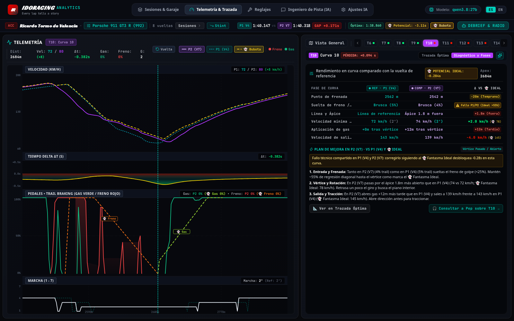
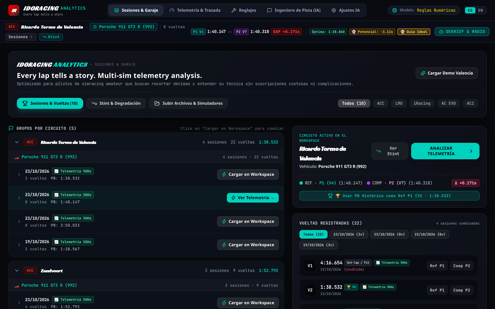

# IdoRacing Analytics 🏎️

> ### **Every lap tells a story.**
> **Multi-sim telemetry analysis. Built for faster laps.**

[](https://github.com/miquelbar/idoracing/actions/workflows/ci.yml)
[](LICENSE)
[](https://www.python.org/)
[](https://react.dev/)
[](https://www.typescriptlang.org/)
[](https://ollama.ai/)

**IdoRacing Analytics** is an open-source telemetry viewer and AI race engineer for sim racers. It lines up two of your laps by distance, shows where the time goes corner by corner, and explains it in plain words, either with a local LLM through Ollama or with a rule-based fallback.


Supports:
- **Assetto Corsa Competizione (ACC)**
- **Le Mans Ultimate (LMU)**
- **Assetto Corsa 1 & Assetto Corsa Rally**
- **Assetto Corsa EVO**
- **DiRT Rally 2.0 & EA SPORTS WRC**
- **iRacing** (MoTeC & CSV exports)
- **Universal 50Hz CSV Logs**

---

## 💡 The Philosophy

- **Free and open source**: runs on your PC or home network, no accounts or paywalls.
- **Local by default**: telemetry and sessions stay in a SQLite file on your machine. Nothing leaves it unless you configure a cloud LLM provider (the web UI also loads its fonts from Google Fonts).
- **100% Data Honesty**: real sessions that only contain lap/sector times (e.g. ACC with `Telemetry Laps = 0` or LMU XML results without a `.ld` file) **never invent or interpolate fake telemetry charts or corner diagnoses**. Instead, the app displays the real timed splits and a step-by-step telemetry activation guide for that simulator. Synthetic telemetry is strictly limited to the explicit **`[ Load Valencia Demo ]`** button.

### 🏝️ The Name & Identity: Why "IdoRacing", "Pep", and "Bubota"?

- **IdoRacing (from *"Idò!"*, not *"I do"*)**: pronounced `/iˈðɔ/` (with the stress on the *ò*), **"Idò"** is the quintessential word from **Mallorca (Balearic Islands, Spain)**. Depending on tone, it means *"Well then!"*, *"So..."*, *"Of course!"*, or *"Let's get to it!"*. When a race engineer looks at your telemetry trace and spots where those three tenths went, the analysis always starts with: *"Idò, look at your braking point in Turn 1..."*
- **Pep — Your AI Race Engineer**: **Pep** is a classic traditional Mallorcan name—and in IdoRacing Analytics, he is your local AI race engineer on the pit wall (**P**erformance **E**ngineering **P**artner). Grounded 100% in physics and verified telemetry metrics, Pep skips generic fluff and tells you directly what happened in `P1` vs `P2`.
- **Bubota — The Ideal Physics Ghost**: In Mallorcan folklore, a ***bubota*** is a ghost. In telemetry analysis, comparing two of your own laps (`P1` vs `P2`) has a blind spot: *what if you made the exact same braking or line mistake on both laps?* **Bubota** (**B**enchmark **U**ltimate **B**raking & **O**ptimal **T**rajectory **A**nalyzer) is the theoretical physics ghost that projects the optimal trail-braking release, apex minimum speed, and throttle ramp for your car's real grip limit, showing how much lap time is still on the table even against your Personal Best.

---

## 🌟 Key Features

### 1. 🗺️ Track map & 50Hz Telemetry Channels (`P1` vs `P2` vs `👻 Bubota`)
- Lap outline coloured by the speed difference between `REF · P1` (Cyan) and `COMP · P2` (Purple).
- **👻 Bubota (Ideal Physics Ghost)**: computes your **Rolling Best (Optimal Lap)** and physical limit envelope ($a_{y,\max}$, optimal diagonal trail braking regression `100% -> 0%` at apex, and progressive throttle pickup), drawing golden dashed `--- 👻 Bubota (Ideal)` curves on Speed and Pedals.
- Click any corner on the map or top bar (`T1`..`T14`) to zoom into its trajectory and phase breakdown.


### 2. 🔍 Corner-by-corner Phase Diagnosis & Optimal Line
- **Explicit Lap Identification (`REF · P1 (V2)` vs `COMP · P2 (V4)` vs `👻 Bubota`)**: every table header, badge, and improvement bullet explicitly cites which lap is being diagnosed—including cross-session dates (`P1 (V2 · 19/10)`) and shared faults (`⚠️ Fallo en P1 y P2 (👻 Bubota: >55%)`).
- **2D Optimal Line Inspector**: compares `P1 (V2)` and `P2 (V4)` apex markers with non-overlapping coordinates and lateral line offset in metres.
- **Ask Pep** about the selected corner in one click.




### 3. 🗄️ Cross-Session Garage & Normalized Workspace
- **Canonical Car & Track Normalization**: unifies internal simulator IDs (`porsche_992_gt3_r`, `992 GT3 R`) under their official name (**`Porsche 911 GT3 R (992)`**, **`Ricardo Tormo de Valencia`**).
- **Cross-Session Lap Comparison**: view all historical laps across all sessions of a `[Circuit + Car]` in a single workspace, filter by session date, see **`📈 Telemetría 50Hz`** vs **`⏱️ Solo Tiempos`** badges, and click **`[ 🏆 Usar PB Histórico como Ref P1 ]`** to compare today's stint against your all-time personal best.



### 4. 🤖 Pep · AI Race Engineer & Team Radio
- **Pep (`PEP · AI RACE ENGINEER & RADIO`)** is your pit-wall race engineer, delivering structured debriefs, setup recommendations, and live team radio answers in Spanish or English.
- **Strict Mathematical Coherence**: `delta = comp - ref`, trail braking `< 25%` is flagged as abrupt release (`Suelta brusca`), and zero false praise is ever given when losing time or apex speed.
- **Local (Ollama)** or **cloud** (any OpenAI-compatible API: OpenAI, OpenRouter, DeepSeek...), with an instant deterministic rule-based engine when offline.

---

## 🎮 How to Record Telemetry in Your Sim

### 🚀 Universal Steam Launcher on Linux (All Simulators)
The recommended and simplest way on Linux with Steam + Proton is the **universal auto-detecting launcher**. It inspects the running binary to determine whether you are playing ACC, LMU, AC1, AC Rally, AC EVO, DiRT Rally 2.0, or EA SPORTS WRC, and hooks `idoracing-recorder.exe` into the game's Proton prefix automatically:

1. In Steam, right-click your simulator > **Properties** > **General** > **Launch Options**.
2. Enter:
   ```bash
   gamemoderun /path/to/idoracing/recorder/linux/sim-with-recorder.sh %command%
   ```
   *(Or without GameMode: `/path/to/idoracing/recorder/linux/sim-with-recorder.sh %command%`)*  
   *(Or with MangoHud: `mangohud gamemoderun /path/to/idoracing/recorder/linux/sim-with-recorder.sh %command%`)*
3. Start the game. The recorder starts silently in the background and closes automatically when the game exits.
4. Telemetry is saved to `IdoRacing/recordings/` and imported automatically by IdoRacing Analytics.

*(Note: The simulator-specific scripts like `acc-with-recorder.sh`, `lmu-with-recorder.sh`, `ac-with-recorder.sh`, `acevo-with-recorder.sh`, and `dr2-with-recorder.sh` remain 100% supported if you already configured them).*

---

### 🪟 Windows Quickstart (All Simulators)
Because `idoracing-recorder.exe` is built as a background GUI process (`-H=windowsgui`), it runs **completely silently**: no black command prompt popups, no taskbar window, and negligible CPU consumption (<0.01% when idle).

- **Option A: Auto-Record on Boot (Recommended — Set & Forget)**:
  1. Press `Win + R`, type `shell:startup`, and press Enter.
  2. Put a shortcut to `idoracing-recorder.exe` in that folder.
  3. Whenever you launch any supported sim (ACC, LMU, AC, AC EVO, DR2, WRC), it automatically detects the game and saves 50Hz telemetry to `Documents\IdoRacing\recordings\`.
- **Option B: Manual / Desktop Shortcut**:
  Double-click `idoracing-recorder.exe` before driving.
- **Option C: Auto-Exit with Specific Game**:
  ```cmd
  idoracing-recorder.exe -exit-with AC2-Win64-Shipping.exe
  idoracing-recorder.exe -sim lmu -exit-with "Le Mans Ultimate.exe"
  idoracing-recorder.exe -sim ac -exit-with "acs.exe,AssettoCorsa.exe"
  idoracing-recorder.exe -sim acevo -exit-with AssettoCorsaEVO.exe
  idoracing-recorder.exe -sim dr2 -exit-with "dirtrally2.exe,WRC.exe"
  ```

---

### 🏎️ Assetto Corsa Competizione (ACC)
- **Automatic Live Recorder (50Hz + GPS coords)**:
  - **Linux (Steam + Proton)**: Add `gamemoderun /path/to/idoracing/recorder/linux/sim-with-recorder.sh %command%` (or dedicated `acc-with-recorder.sh %command%`).
  - **Windows**: Run `idoracing-recorder.exe -exit-with AC2-Win64-Shipping.exe` (or use `-sim auto`).
  - **Data Captured**: Shared memory (`Local\acpmf_physics`, `graphics`, `static`), speed, inputs, steer angle, G-forces, tyre pressures, and real $(x, y)$ world coordinates. Laps cut-short or exceeding track limits are flagged automatically using ACC's native `lap_valid` signal.
- **Native MoTeC Export (Fallback)**:
  - In ACC, enter Car Setup > Electronics/Fuel and set **Telemetry Laps** to **10–20** (default `0` = off).
  - ACC writes `.ld` and `.ldx` files to `Documents\Assetto Corsa Competizione\MoTeC\`.

### 🏁 Le Mans Ultimate (LMU)
- **Automatic Live Recorder (50Hz + GPS coords)**:
  - Requires `rFactor2SharedMemoryMapPlugin64.dll` inside `<Le Mans Ultimate>/Plugins/` and `" Enabled": 1` in `<Le Mans Ultimate>/UserData/player/CustomPluginVariables.JSON`.
  - **Linux (Steam + Proton)**: Add `gamemoderun /path/to/recorder/linux/sim-with-recorder.sh %command%` (or dedicated `lmu-with-recorder.sh %command%`).
  - **Windows**: Run `idoracing-recorder.exe -sim lmu -exit-with "Le Mans Ultimate.exe"` (or use `-sim auto`).
  - **Data Captured**: Real-time 50Hz telemetry (`$rFactor2SMMP_Telemetry$`, `$rFactor2SMMP_Scoring$`), speed, pedals, steering, G-forces, and world $(x, y)$ position.
- **Session Results XML (Fallback)**:
  - LMU automatically writes practice, qualifying, and race XML results to `UserData/Log/Results/`.
  - IdoRacing automatically discovers and imports these files, displaying lap times and sector deltas.
- **MoTeC DAMPlugin (Fallback)**:
  - If you use DAMPlugin, place or upload the generated `.ld` file from `UserData/Log/MoTeC/`.

### 🏎️ Assetto Corsa 1 (AC)
- **Automatic Live Recorder (50Hz + GPS coords)**:
  - **Linux (Steam + Proton)**: Add `gamemoderun /path/to/idoracing/recorder/linux/sim-with-recorder.sh %command%` (or dedicated `ac-with-recorder.sh %command%`).
  - **Windows**: Run `idoracing-recorder.exe -sim ac -exit-with "acs.exe,AssettoCorsa.exe"` (or use `-sim auto`).
  - **Data Captured**: Shared memory (`Local\acpmf_physics`, `graphics`, `static`), closed-circuit trajectory with start/finish loop-closure drift correction, speed, pedal positions, and G-forces.
- **MoTeC Export (Fallback)**:
  - Use the ACTIR MoTeC telemetry app; exports `.ld` files to `Documents/Assetto Corsa/MoTeC/`, which are auto-imported on startup.

### 🌲 Assetto Corsa Rally (AC Rally)
- **Automatic Live Recorder (50Hz + GPS coords)**:
  - AC Rally point-to-point stages (e.g. rally stages, hillclimbs) use the AC physics engine with non-looping start/finish coordinates.
  - **Linux (Steam + Proton)**: Add `gamemoderun /path/to/idoracing/recorder/linux/sim-with-recorder.sh %command%` (or dedicated `ac-with-recorder.sh %command%`).
  - **Windows**: Run `idoracing-recorder.exe -sim ac -exit-with "acs.exe,AssettoCorsa.exe"` (or use `-sim auto`).
  - **Point-to-Point Handling**: The recorder detects when start and finish positions differ by more than 30 metres, preserving the authentic linear trajectory without closing false loops.

### ⚡ Assetto Corsa EVO (AC EVO)
- **Automatic Live Recorder (50Hz + GPS coords)**:
  - **Linux (Steam + Proton)**: Add `gamemoderun /path/to/idoracing/recorder/linux/sim-with-recorder.sh %command%` (or dedicated `acevo-with-recorder.sh %command%`).
  - **Windows**: Run `idoracing-recorder.exe -sim acevo -exit-with AssettoCorsaEVO.exe` (or use `-sim auto`).
  - **Data Captured**: Shared memory (`Local\acevo_pmf_*` with fallback to `Local\acpmf_*`), capturing 50Hz physics channels and world $(x, y)$ coordinates.
- **Native MoTeC Export**:
  - In the in-game garage setup menu, set **Telemetry Laps > 0**. Files are saved to `Saved Games/ACE/MoTec/<car>/<track>/` and auto-imported.
- **Native Session Results**:
  - AC EVO automatically logs session results in JSON format under `Saved Games/ACE/Results/*.sessionresults.json`.

### 🏔️ DiRT Rally 2.0 (DR2)
- **Automatic Live Recorder (100Hz UDP Stream)**:
  1. Enable UDP output in `hardware_settings_config.xml` (located in `Documents/My Games/DiRT Rally 2.0/hardwaresettings/`):
     ```xml
     <udp enabled="true" extradata="3" ip="127.0.0.1" port="20777" delay="1" />
     ```
  2. **Linux (Steam + Proton)**: Add `gamemoderun /path/to/idoracing/recorder/linux/sim-with-recorder.sh %command%` (or dedicated `dr2-with-recorder.sh %command%`).
  3. **Windows**: Run `idoracing-recorder.exe -sim dr2 -exit-with dirtrally2.exe` (or use `-sim auto`).
  4. **Data Captured**: Decodes Codemasters 100Hz UDP packets (`extradata=3` format: 264 bytes) recording stage time, distance covered, speed, throttle, brake, steering, RPM, G-forces, and point-to-point $(x, y)$ stage geometry.

### 🏜️ EA SPORTS WRC (WRC)
- **Automatic Live Recorder (100Hz UDP Stream)**:
  1. Enable UDP output in `hardware_settings_config.xml` (located in `Documents/EA SPORTS WRC/hardwaresettings/`):
     ```xml
     <udp enabled="true" extradata="3" ip="127.0.0.1" port="20777" delay="1" />
     ```
  2. **Linux (Steam + Proton)**: Add `gamemoderun /path/to/idoracing/recorder/linux/sim-with-recorder.sh %command%` (or dedicated `dr2-with-recorder.sh %command%`).
  3. **Windows**: Run `idoracing-recorder.exe -sim dr2 -exit-with WRC.exe` (or use `-sim auto`).
  4. **Data Captured**: Receives 100Hz UDP telemetry on port 20777, recording stage split times, linear progress, steering angle, inputs, and trajectory.

### 🏁 iRacing
- **In-Game Telemetry Logging**:
  1. While in the car, press **`Alt + L`** to toggle telemetry recording on/off (the in-car dashboard displays a `TELEM` indicator).
  2. iRacing writes binary `.ibt` files to `Documents/iRacing/telemetry/`.
  3. Convert or export to `.ld` (using the free MoTeC iRacing plugin) or export as CSV via Mu / Atlas.
  4. Drag and drop the resulting `.ld` or `.csv` file into IdoRacing Analytics, or place it in the auto-import directory.

### 📊 Universal 50Hz CSV Logs
- **Custom Hardware & Third-Party Recorders**:
  - Any data logger, data acquisition unit, or custom script can export CSV files with leading metadata headers:
    ```text
    # simulator: Custom Sim
    # track: Spa-Francorchamps
    # car: Porsche 911 GT3 R
    time,lap,lap_distance,speed,throttle,brake,steer_angle,lat_accel,long_accel,x,y,lap_valid
    ```
  - Place your CSV files in `Documents/IdoRacing/recordings/` or drag and drop them directly into the web UI.

---

### 📂 Telemetry Auto-Discovery Directory Reference

IdoRacing Analytics scans the following paths automatically on startup or when clicking **"Escanear Telemetría"**:

| Simulator | File Types | Default Linux (Steam Proton) Path | Default Windows Path |
| :--- | :--- | :--- | :--- |
| **All Simulators (IdoRacing Recorder)** | `*.csv` | `~/.local/share/Steam/steamapps/compatdata/*/pfx/drive_c/users/steamuser/Documents/IdoRacing/recordings/` | `C:\Users\<User>\Documents\IdoRacing\recordings\` |
| **Assetto Corsa Competizione** | `*.ld`, `*.ldx` | `.../compatdata/805550/.../Documents/Assetto Corsa Competizione/MoTeC/` | `Documents\Assetto Corsa Competizione\MoTeC\` |
| **Le Mans Ultimate** | `*.xml` | `~/.local/share/Steam/steamapps/common/Le Mans Ultimate/UserData/Log/Results/` | `<SteamLibrary>\steamapps\common\Le Mans Ultimate\UserData\Log\Results\` |
| **Assetto Corsa 1** | `*.ld` | `.../compatdata/244210/.../Documents/Assetto Corsa/MoTeC/` | `Documents\Assetto Corsa\MoTeC\` |
| **Assetto Corsa EVO** | `*.ld`, `*.json` | `.../compatdata/3058630/.../Saved Games/ACE/` (`MoTec/` and `Results/`) | `Saved Games\ACE\` (`MoTec\` and `Results\`) |
| **iRacing** | `*.ld`, `*.csv` | `~/Documents/iRacing/Telemetry/` | `Documents\iRacing\telemetry\` |

---

## 🏗️ Architecture

```
idoracing/
├── api/                # FastAPI app: REST endpoints and built frontend static server
├── frontend/           # React 19 + TypeScript + Vite + Tailwind CSS
│   ├── src/components/ # Charts, track inspector, debrief drawer, garage inspector
│   ├── src/views/      # Sessions, telemetry, car setup, engineer radio, settings
│   ├── src/services/   # Typed API client
│   └── src/types/      # API telemetry types
├── domain/             # Pydantic models (Session, Lap, LapComparison, CoachReport)
├── importers/          # MoTeC .ld/.ldx, LMU XML, ACEVO JSON and 50Hz/100Hz CSV importers
├── analysis/           # Distance alignment, corner phase diagnostics, Bubota ideal ghost
├── storage/            # SQLite persistence for sessions, laps, setups and debriefs
├── coach/              # LLM clients, Pep pit-wall radio and rule-based advisor
├── recorder/           # Standalone Go 50Hz/100Hz recorder (ACC, LMU, AC, ACEVO, DR2, WRC)
│   ├── linux/          # Steam Proton launch scripts & universal sim-with-recorder.sh
│   └── tools/          # fakeacc & fakelmu testing harness
└── tests/              # pytest suite (importers, physics, advisors, API)
```

---

## 🚀 Quickstart

### Option A: Local Python & Node (Recommended)

#### 1. Prerequisites
- Python 3.11+
- Node.js 20+ and npm

#### 2. Clone & Setup Backend
```bash
git clone https://github.com/miquelbar/idoracing.git
cd idoracing

# Create and activate Python virtual environment
python3 -m venv .venv
source .venv/bin/activate

# Install Python dependencies
pip install -r requirements.txt
```

#### 3. Build Frontend
```bash
cd frontend
npm install
npm run build
cd ..
```

#### 4. (Optional) Setup Local AI with Ollama
If you want free, 100% private AI race coaching:
```bash
# Install Ollama (https://ollama.ai)
curl -fsSL https://ollama.ai/install.sh | sh

# Pull a model (any Ollama chat model works; set OLLAMA_MODEL to its tag)
ollama pull qwen3.8:27b
```
*(Alternatively, configure an OpenAI-compatible API key in the web app under **Ajustes IA** / **AI Settings**, or in `.env`.)*

#### 5. Launch IdoRacing Analytics
```bash
source .venv/bin/activate
uvicorn api.server:app --host 127.0.0.1 --port 8501
```

Open your browser at `http://localhost:8501`.

The API has no authentication. Binding to `0.0.0.0` makes it reachable from your LAN, including the settings endpoint that holds your cloud API key; only do that on a network you trust.

---

### Option B: Docker Compose

1. **Configure environment:**
   ```bash
   cp .env.example .env
   ```

2. **Launch with Docker Compose:**
   ```bash
   docker compose up --build
   ```

3. Access the web app at `http://localhost:8501`.

---

## 🧪 Testing & Code Quality

```bash
pip install -r requirements.txt ruff
pytest
ruff check . && ruff format --check .

cd frontend && npm ci && npm run build && npm run lint
```

There are no frontend tests yet; `npm run build` type-checks the app in strict mode.

---

## 🛠️ Configuration (.env)

| Variable | Default | Description |
|---|---|---|
| `LLM_PROVIDER` | `ollama` | AI Provider: `ollama` or `openai` |
| `OLLAMA_BASE_URL` | `http://localhost:11434` | Ollama API endpoint |
| `OLLAMA_MODEL` | `qwen3.8:27b` | Local model name (e.g., `qwen3.8:27b`, `qwen3:14b`) |
| `OLLAMA_TIMEOUT` | `90.0` | Timeout in seconds for AI response generation |
| `OPENAI_API_KEY` | *(empty)* | Optional API key for OpenAI / OpenRouter / DeepSeek |
| `OPENAI_BASE_URL` | `https://api.openai.com/v1` | Optional endpoint (use `https://openrouter.ai/api/v1` for OpenRouter) |
| `OPENAI_MODEL` | `gpt-4o-mini` | Model name when using OpenAI provider |
| `AI_ENABLED` | `true` | Enable or disable AI coaching functionality |
| `IDORACING_DB_PATH` | `data/idoracing.db` | Local SQLite database file path |

---

## 🤝 Contributing

Contributions are warmly welcome! Whether you are:
- Adding support for new simulators (Automobilista 2, BeamNG.drive, RaceRoom, rFactor 2)
- Enhancing corner detection algorithms or tire slip angle calculations
- Improving the UI or adding new telemetry charts
- Reporting bugs or suggesting features

Feel free to open an issue or submit a pull request. Please check [CONTRIBUTING.md](CONTRIBUTING.md) for contribution guidelines.

---

## 📄 License

This project is licensed under the [GNU General Public License v3.0](LICENSE).

The MoTeC `.ld` reader in `importers/motec_binary.py` is based on the file layout documented by [gotzl/ldparser](https://github.com/gotzl/ldparser) (GPL-3.0). The Sebring centreline in `data/circuits/sebring.json` is derived from OpenStreetMap data, © OpenStreetMap contributors, available under the [Open Database License](https://opendatacommons.org/licenses/odbl/). See [NOTICE](NOTICE) for details.

Enjoy faster laps and cleaner racing! 🏁
